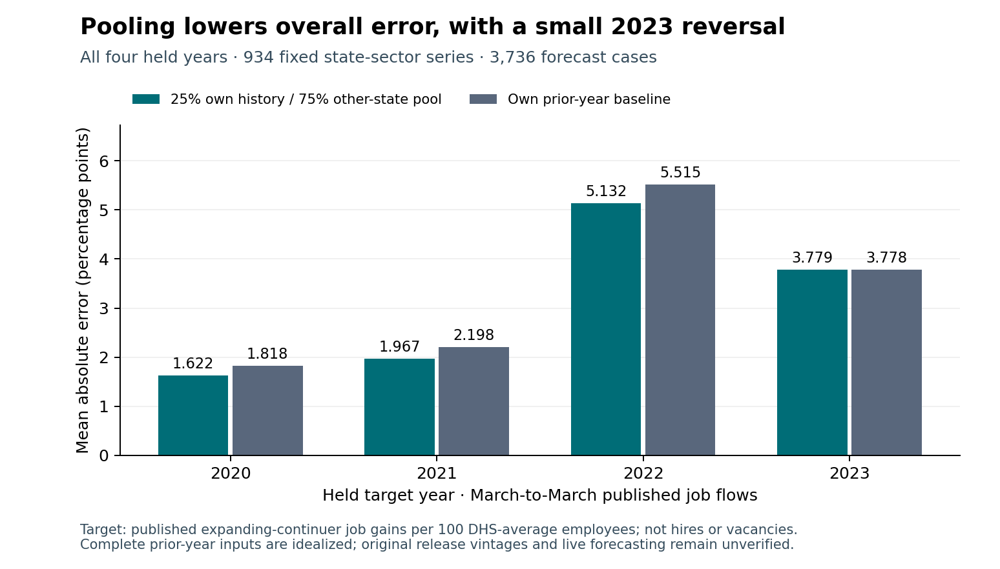

# Establishment growth signals

A fixed 25% own-history / 75% other-state pool has held equal-series MAE 3.125 percentage points versus 3.327 for the own-lag baseline, a 6.1% reduction across 934 state-sector series and 3,736 annual cases. The selected model is worse in 428 series and four of nineteen sectors, and slightly worse in 2023. All failures remain in the result tables.

The target is a published expansion-rate proxy: job gains at expanding continuing establishments per 100 DHS-average employees in the whole state-sector cell. It is not worker hires, job vacancies or a demonstrated labor shortage. This is a retrospective revised-data comparison; complete prior-year inputs are idealized and original information vintages remain unverified.

Use the pooled model as a benchmark candidate, with its own-lag alternative and local failure record visible. Show opening and continuer components separately, preserve unavailable cells and verify dated release availability before an operational forecast. Current hiring or staffing decisions require timely vacancy, worker-flow and business evidence.

Read the [decision summary and complete tables](DECISION_SUMMARY.md), [fixed protocol](PROTOCOL.md), [source record](data/README.md), [frozen choice](FREEZE.json), [all results](results) and [independent manuscript](paper/manuscript.pdf).



```text
python -m pip install -r requirements.txt
python -m unittest discover -s tests -v
python src/check_reproduction.py
python src/verify_figures.py
python src/verify_paper.py
python src/verify_public_package.py
```

Sixteen fixtures; 26 dependencies frozen before held results; independent SQL and rational/decimal verification; exact isolated replay. Not peer reviewed. Formal-publication projects including Azure remain private.
